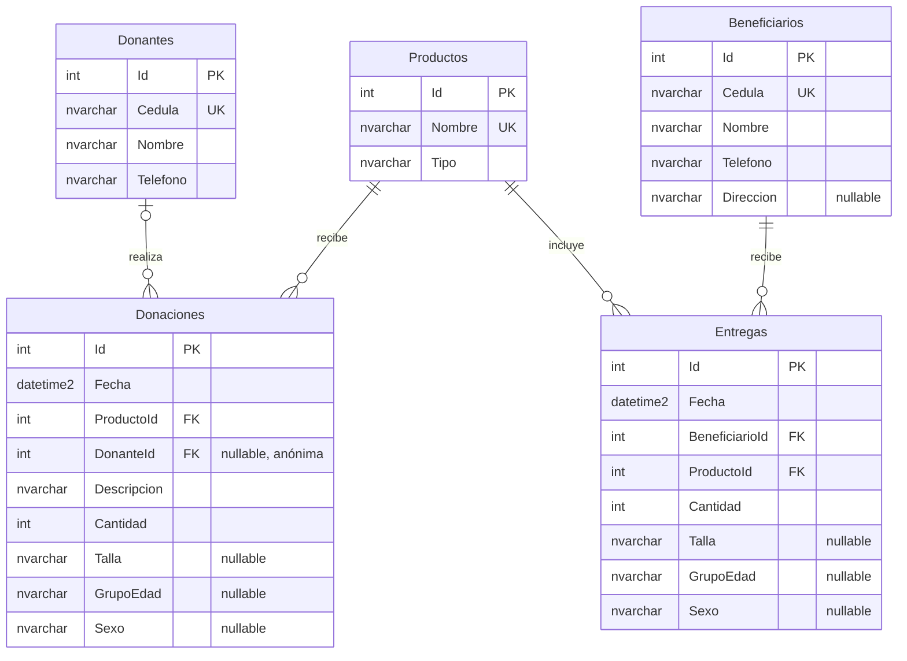

# Modelo de datos acordado

El diagrama refleja las cinco tablas y sus relaciones especificadas en la guía. Las cardinalidades representan las claves foráneas del script.

La clave de inventario es ProductoId y, para ropa, también Talla, GrupoEdad y Sexo. Los tres campos de ropa son todos nulos para artículos que no son ropa o todos tienen valor para ropa. Las relaciones no usan borrado en cascada.
