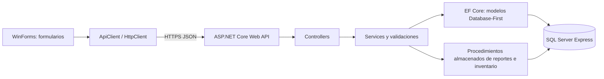
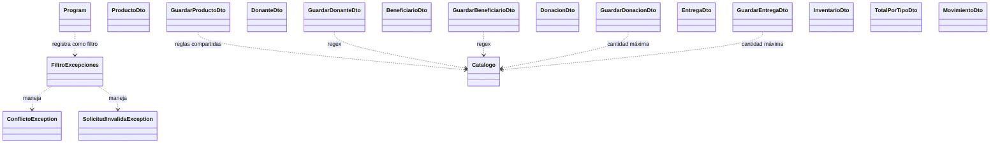

# Diagramas de arquitectura y clases

## Arquitectura por capas (acordada)

WinForms no se conecta a SQL Server. La API aplica las validaciones y es la autoridad para calcular y proteger el stock.

## Clases de la API presentes en esta copia

El siguiente diagrama solo nombra tipos que existen en el `main` recibido. Controllers, interfaces, services y modelos EF todavía no están implementados; no se inventan sus métodos ni relaciones.

## WinForms

Los formularios, `ApiClient`, `ApiException`, DTOs y `Mensajes` no están incluidos todavía en esta copia. El diagrama de clases de WinForms y las capturas deben añadirse después de integrar el proyecto real; hacerlo antes supondría adivinar nombres y relaciones.
